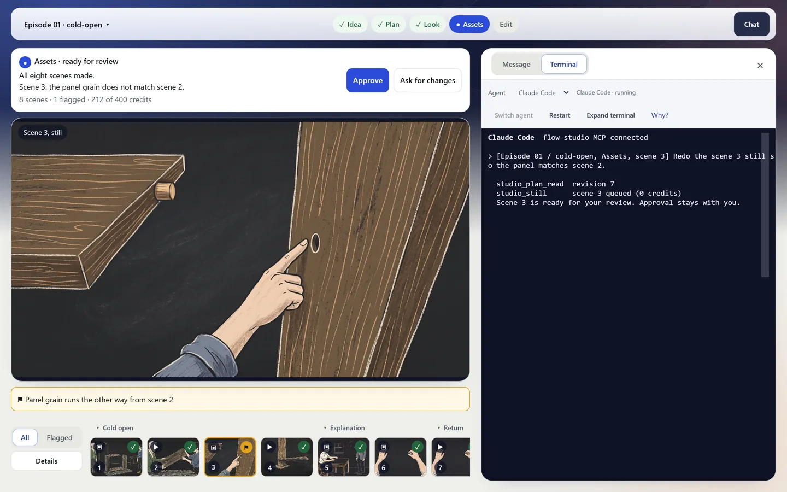
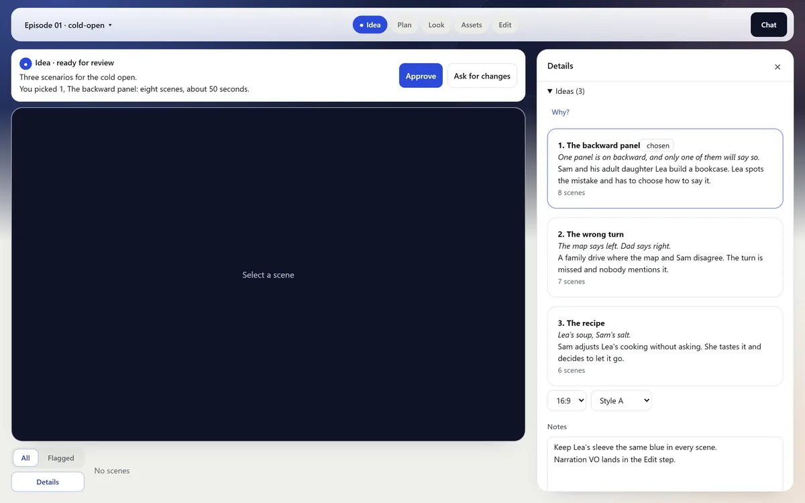
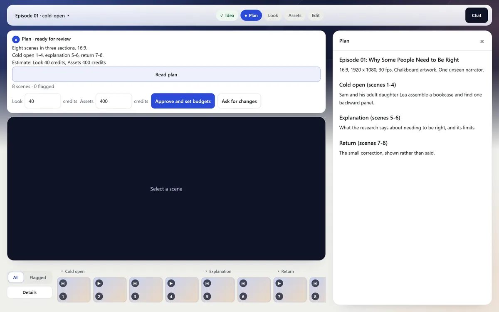
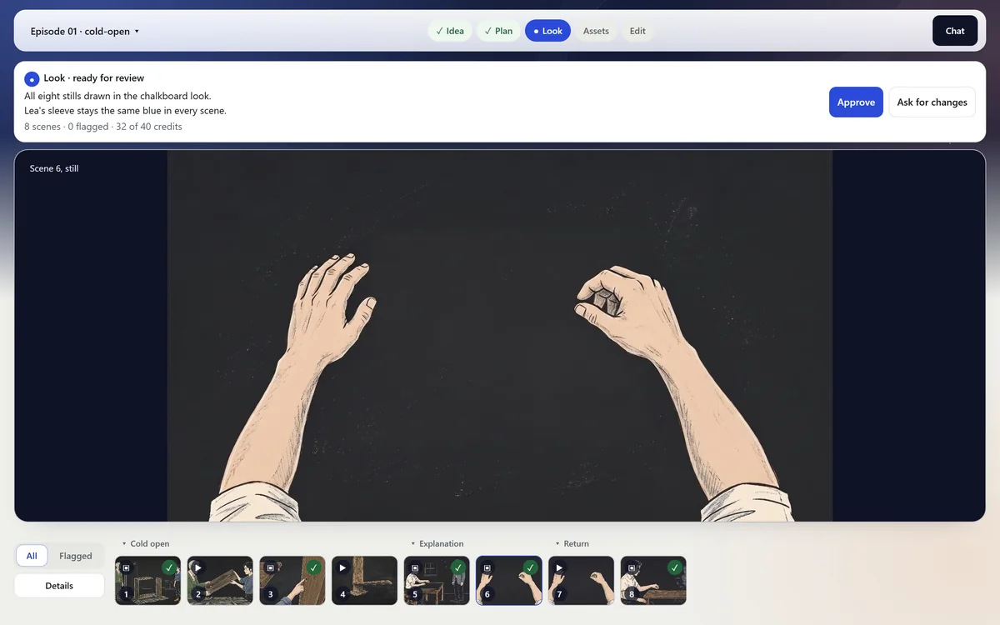
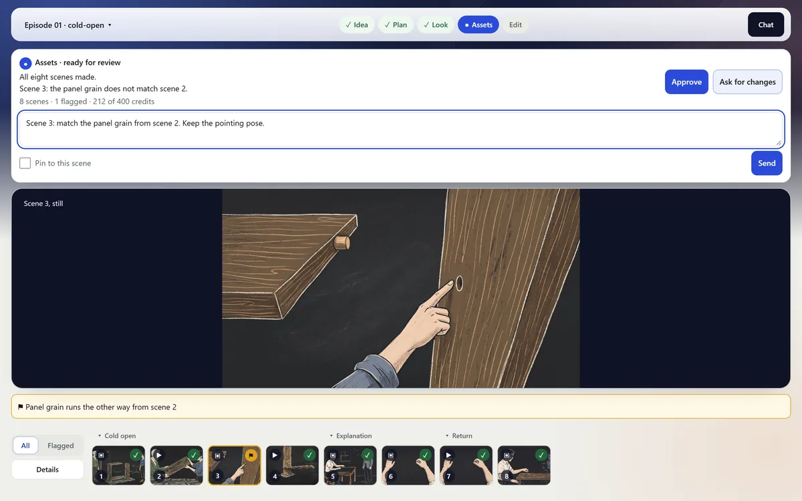
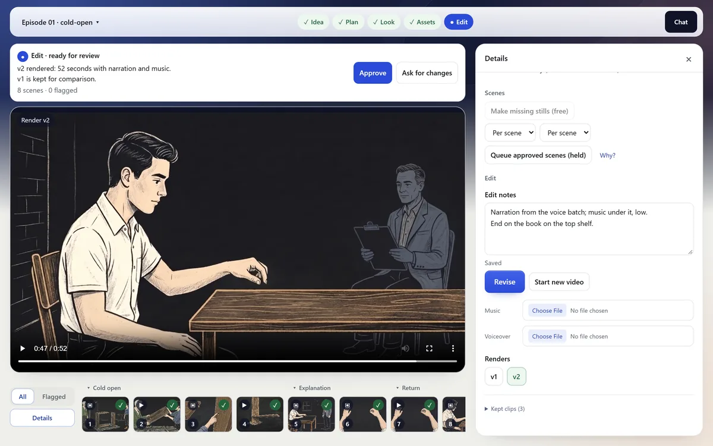

# Flow Studio

[](https://github.com/bitwindamountains/flow-studio/actions/workflows/ci.yml)

A local Windows app for making short videos with an AI agent. It plans the video, generates stills and clips in Google Flow, and edits the result in Remotion. The owner approves each step and every credit spent.

It is built on [flow-mcp](https://github.com/GTAI-1/flow-mcp) by GTAI-1, copied into `engine/`, which drives the real Google Flow web UI in its own browser profile. Flow Studio adds the five-step workflow with approval gates and budgets, the Studio window, the embedded agent terminal, the review desk and the Remotion handoff. See [engine/NOTICE.md](engine/NOTICE.md).



## Walkthrough

*The real interface against a test API: no live Studio and no credits spent.*

**1. Pick the idea.** The agent writes a few scenarios. You pick one in chat and approve the Idea step.



**2. Approve the plan and budgets.** The Plan gate shows the whole plan and the agent's credit estimate. Approving sets the budget for each paid step.



**3. Check the look.** Every scene gets a still before any clip is paid for.



**4. Ask for changes.** A change request is attached to the step and can be pinned to the selected scene.



**5. Review the cut.** The agent edits in Remotion and renders numbered versions. You watch the cut, add edit notes and approve it.



## How it works

A video moves through five steps: **Idea, Plan, Look, Assets, Edit**. An embedded agent (Claude Code by default, Codex CLI optional) does the work for each step. Each step then stops at a gate, where the owner approves it or asks for changes in the Studio window.

- Paid Flow jobs wait for the owner's approval, or run inside a step budget the owner set at a gate.
- The agent can't approve steps, set budgets, mark takes as kept or restore takes.
- Renders are versioned (`v1.mp4`, `v2.mp4`, …) and earlier audio, compositions and renders are never overwritten.

## Requirements

- Windows 10 or later
- Node.js (built and tested on 24)
- Brave (Edge works as a fallback for the Studio window)
- ffmpeg, for continuing a clip from its last frame (`winget install Gyan.FFmpeg`)
- A Google account with Flow access. You sign in by hand in the Studio's browser profile.
- The Remotion workspace at `remotion/` (see below). It is not part of this repository.

## Remotion workspace (set up separately)

The Edit step renders in Remotion, and git ignores `remotion/`, so a fresh clone does not have it. Create it like this:

```
remotion/
  my-video/                  # a Remotion project (npx create-video@latest my-video), then npm install
  .claude/skills/
    remotion-style-a/        # editing style skill: SKILL.md, assets/, references/
    remotion-style-b/        # editing style skill: SKILL.md, assets/
```

- `my-video` uses Remotion 4.0.539 with the official `@remotion/*` packages (captions, media, fonts, transitions and more). Install the ones its compositions import.
- Both embedded agents start in `remotion/` so that Claude Code loads the two style skills. The agents follow `remotion-style-a` or `remotion-style-b`, depending on the plan's style.
- The style skills are kept in this repo under `remotion-skills/`. Copy them into place: `cp -r remotion-skills/* remotion/.claude/skills/`. The copy in `remotion/.claude/skills/` is the one the agents use. After editing a skill there, copy it back to `remotion-skills/` and commit it.
- Studio writes clips to `my-video/public/<project>/<sub>/clips/` and renders to `my-video/out/<project>/<sub>/v<N>.mp4`.

## Run

```
cd engine
npm install
```

Then double-click `Flow Studio.cmd`. It builds the engine, starts the server on port 8797 and opens the Studio window. Close the console window to stop it.

Local state lives in `data/` and project media lives in `projects/`. Git ignores both folders.

## Test

263 unit tests, plus isolated browser checks of the Studio window.

```
cd engine
npm test               # unit tests (temporary fixtures, no Flow, no credits)
npm run test:workflow  # isolated browser checks of the Studio UI
npm run test:terminal
npm run test:desk
```

## Repository layout

| Path | What it is |
|---|---|
| `engine/` | flow-mcp server, Studio server and MCP tools (TypeScript) |
| `ui/` | Studio window (plain HTML, CSS, JavaScript and xterm) |
| `claude/` | Embedded agent settings, MCP config and studio prompt |
| `scripts/` | Launcher preflight |
| `remotion-skills/` | Backup of the Remotion editing style skills (A and B) |
| `docs/` | How the review desk, workflow, Codex terminal and Flow accounts behave, plus the creative prompt guide |
| `AGENTS.md`, `CLAUDE.md` | Rules and current status for the agents |
| `DESIGN.md`, `PRODUCT.md` | UI design system and product notes |
